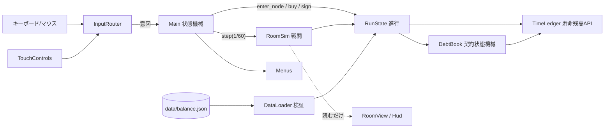
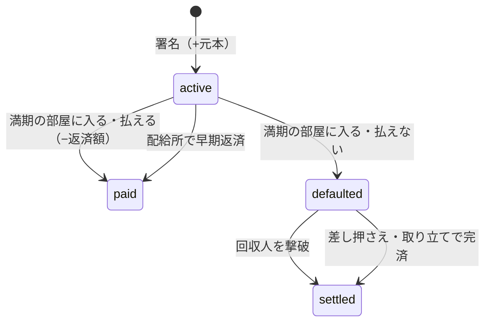

# アーキテクチャ（縦切りスライス / TypeScript 版）

> 2026-10 に Godot から TypeScript へ移行（ADR-012）。名前はファイルに読み替える: `src/sim/timeLedger.ts` / `debtBook.ts` / `runState.ts` / `roomSim.ts`、表示は `src/view/`、画面は `src/ui/menus.ts`（HTML）、状態機械とループは `src/main.ts`。

## 寿命の流れ（単一の残高管理API）

すべての増減は `TimeLedger.change(delta, reason)` を通る。reason は `drain / hit / collector / boss / skill / purchase / repay / loan / drop / rest`。

| 規則 | 実装 |
|---|---|
| 上限 3600 秒、超過は切り捨てて通知 | `change()` 内で `truncated` に記録 |
| 0 で死亡、1回だけ | `dead` フラグ。以後の `change()` は無視 |
| 支払いで 0 にはならない | `can_pay(cost)` = `time - cost > 0` |
| 残高の整合性 | `start + gained − spent == time` をボットテストで検証 |

## 契約の状態機械

- 満期判定は `RunState.enter_node()` の中だけ。`processed` に部屋番号を入れて二重実行を防ぐ。
- ボス部屋の入口では満期前の契約も含めて全件処理する（クリア判定までに必ず清算される）。
- 滞納中は戦闘部屋に回収人が**合算で1体**（体力は滞納額に比例）。ドロップの40%を差し押さえ、回収人の攻撃は寿命を奪いつつ借金に充当される。

## 部屋遷移の順序

1. 扉に触れる → ルート選択画面（時計停止）
2. 区画を選ぶ → `enter_node()`：部屋番号を進める → 満期処理（1回だけ）→ 死亡判定
3. 次の区画を開く（戦闘 / ショップ / 契約 / 休憩）

遷移中の再入は `_transitioning` で無視。返済は残高が 0 にならない時しか行わないので、遷移中に死亡することはない。

## 1ティックの処理順（`RoomSim.step`）

1. プレイヤー移動・射撃 → 2. 自弾の命中 → 3. 撃破（回収人の清算・ドロップ）→ 4. 敵AI・被弾 → 5. 時間片の回収（差し押さえ）→ 6. 時計の減少 → 7. ウェーブ・クリア判定

同フレームで「回収人の撃破」と「被弾」が起きたら、清算が先。「購入」と「被弾」はそもそも同じ状態で起きない（購入は時計停止中のみ）が、続けて起きても `TimeLedger` の逐次処理で整合する。

## seed と乱数

| ストリーム | 用途 |
|---|---|
| map | 分岐ルートの候補・部屋の地形 |
| enemy | 敵の構成・出現位置・ボスの召喚位置 |
| reward | 戦闘報酬の3択 |
| misc | ドロップの散らばり・弾のぶれ |

同じ seed なら部屋候補・敵構成・報酬候補は一致する（`test_seed_reproducible`）。操作やFPSの差まで完全一致はさせない（仕様書 §16-7）。

## 敵の移動

視線が通ればプレイヤーへ直進、柱で遮られていれば 40px グリッドの BFS 距離場（0.25秒ごとに更新）を下る。オートエイムは視線の通る敵を優先する。
